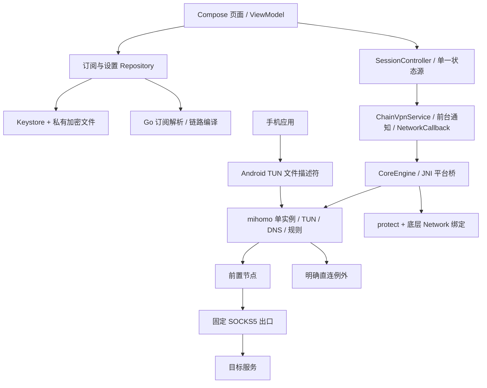
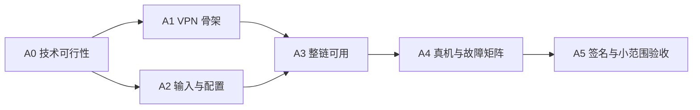

# ChainDesk Android Implementation Plan

## 独立安卓 App 分阶段开发执行计划

> **For agentic workers:** REQUIRED SUB-SKILL: Use superpowers:subagent-driven-development or superpowers:executing-plans to implement this plan task-by-task. Steps use checkbox (`- [ ]`) syntax for tracking. 本次仅交付计划，不开始产品实现；执行方式在实际开工时确定。

**Goal:** 基于当前 ChainDesk 的链式代理业务，开发可独立安装、无需电脑和 Root 的安卓客户端，交付用于自用或小范围分发的签名 APK。

**Architecture:** 建议采用 Kotlin / Jetpack Compose 原生界面，Android `VpnService` 管理流量接管与生命周期，以 JNI 接入固定源码版本的 mihomo 原生库。移植现有订阅校验、链路生成、检测和恢复语义；Windows 服务、代理恢复机制和桌面界面不直接搬入安卓程序。

**Tech Stack:** Kotlin、Jetpack Compose、Coroutines / StateFlow、Android Keystore、Go / mihomo、JNI / NDK / CMake、Gradle Kotlin DSL、ADB 与 Android 测试工具。

**Spec:** 本文件第 1～7 节为范围及设计约束，第 8～12 节为对应执行任务、验收、排期和交付要求；现有桌面基线仅作为行为参照。

| 文档项 | 内容 |
| --- | --- |
| 编制日期 | 2026-11-19，Asia/Shanghai |
| 文档版本 | v1.0，开发前计划 |
| 项目目录 | `E:\VPN\LSDL` |
| 本文档目录 | `E:\VPN\LSDL\APK` |
| 用户已确认 | 独立安卓 App，包含现有链式代理；签名 APK，自用或小范围分发 |
| 本文建议、尚未作为用户确认项 | 原生技术路线、Android 8.0+ / ARM64 支持基线、阶段排期、人员配置与验收指标 |
| 当前状态 | Android 代码、工具链和真机行为均未通过本次开发验证；下文“完成条件”均为未来验收门槛 |

## Global Constraints

- 只新增 Android 所需内容；桌面 M0～M3 封版产物、Windows 构建与真实用户配置不修改。
- 实现前按根目录 [AGENTS.md](../AGENTS.md) 关联预先存在的需求 Issue，或取得维护者认可的跟踪记录；本次不创建或修改 GitHub Issue。
- 测试使用专用订阅、前置与 SOCKS5 出口，不读取或打包用户真实凭证。
- 两跳固定为“一个前置节点 + 一个指定 SOCKS5 出口”；不隐式降级为直连或前置直出。
- 首版仅承诺经 Android 验收的 TCP 组合；不把桌面通过、内核支持、配置可解析等同于 Android 整链可用。
- 文档中目录、接口名和参数为实施约定；`android/`、`core/` 等尚未创建，命令在相应阶段完成后才可执行。

## Review Focus

1. IPv6、非 DNS 的 UDP / QUIC、Private DNS 和 IPv6-only 网络是否绕过链路：由 A1、A3、A4 抓包验证。
2. `protect(fd)` 未覆盖某类原生连接、底层网络更换或回调失败是否造成回环／直出：由 A0、A1、A4 故障注入验证。
3. 取消、网络切换和旧探测结果同时到达时，界面是否错误显示已连接：由 A3 的会话代次和状态迁移验证。
4. 原生崩溃、强行停止、VPN 授权撤销时，系统流量是否恢复直连：由 A4 明确验证并披露保护边界。
5. 加密文件恢复到另一设备、密钥失效、更新失败是否丢失最后可用配置或泄露凭证：由 A2、A5 验证。

## 1. 项目目标与范围界定

### 1.1 可检查的项目目标

首版应让用户完成“安装 → 导入订阅 → 配置出口 → 选择前置 → 授权 VPN → 检测并连接 → 查看出口与状态 → 断开”，全过程不依赖桌面程序、Root、ADB 或手动编辑 YAML。

核心链路为：

```text
手机应用的受代理 TCP 流量
    → Android VPN / TUN
    → mihomo
    → 前置节点（SS / VMess / VLESS / Trojan / AnyTLS 的已验收组合）
    → 用户指定 SOCKS5 出口
    → 目标服务
```

“国内直连”预设中的明确规则例外按直连处理。“指定出口”不代表已证明该供应商提供住宅、独享或永久固定 IP。

| 成功标准 | 首版验收口径 |
| --- | --- |
| 独立运行 | 受支持 ARM64 真机安装签名 APK 后，离开电脑仍可完成全部核心操作 |
| 两跳真实生效 | 专用前置与出口均记录到流量，测试目标观察到出口地址；前置不可直接访问最终测试目标 |
| 不隐式回退 | 前置、出口、认证、代理 DNS 任一关键环节失败，受代理流量不改走 DIRECT |
| 真实状态 | `Connected` 需内核就绪、整链 HTTPS 验证通过；IP 观察结果单独展示，不伪造成功 |
| 恢复与切换 | Wi-Fi / 蜂窝切换、网络暂失和前置切换后重新检测；固定出口保持不变 |
| 数据保护 | 凭证与订阅令牌加密保存；诊断、通知、日志和交付包中没有明文秘密 |
| 可维护交付 | 同一发布证书支持覆盖升级；提供对应源码、构建输入、依赖清单与安装说明 |

### 1.2 首版必须包含

- 一个活动订阅：本地 UTF-8 Clash/Mihomo YAML 和 HTTPS 链接；用户主动更新，更新失败保留旧版。
- 一个固定 SOCKS5 出口：IPv4 或域名、端口、无认证或用户名／密码认证、可选择记住凭证。
- 前置节点合法性校验、排除节点、手动选择；最多三个候选的受控自动选择与故障恢复。
- 全部受代理流量走指定出口、国内直连两种预设；明确展示局域网与启动解析例外。
- Android VPN 授权、前台服务、常驻状态通知、断开操作、网络变化监听。
- 整链 HTTPS 检测、IPv4 出口观察、用户确认的预期 IP、最后可用配置和脱敏诊断导出。
- 中文界面、基本无障碍与字体缩放、后台运行说明、关于与第三方许可。
- ARM64 签名 APK、安装与升级说明、源码及构建资料。

### 1.3 首版不包含

Google Play 上架、账号／云同步／支付、多出口并发、任意多跳拓扑、通用订阅转换、订阅脚本执行、远程控制、热点共享、工作资料跨用户接管、电视／平板专门布局、32 位手机、iOS、Windows 功能重构。

IPv6 出站、通用 UDP / QUIC、Hysteria2、TUIC、WireGuard、WebSocket、gRPC、Reality、SS 插件及任意供应商配置均不作首版兼容承诺。系统级始终开启 VPN / lockdown 与开机自动连接单独延期；不能据此宣传“任何情况下都不会直连”。

### 1.4 平台与范围变更规则

| 项目 | 计划基线 |
| --- | --- |
| 最低系统 | 建议 Android 8.0，`minSdk = 26`；A0 必须有最低版本测试资源，否则在支持声明前调整范围 |
| 编译／目标 SDK | 建议 `compileSdk = 37`、`targetSdk = 37`；官方资料已列 Android 17 / API 37，A0 复核工具链兼容性 |
| 正式 ABI | `arm64-v8a`；`x86_64` 仅用于模拟器与 CI，不作为手机发行承诺 |
| 分发 | 签名 APK，由用户手动安装或覆盖升级；不接入安装权限申请和应用内自更新 |
| 设备状态 | 正常解锁设备，非 Root 必需；不依赖 Google Play 服务 |
| 技术路线状态 | 本文推荐方案；若 A0 发现不能满足核心验收，先更新计划和估算，再进入后续阶段 |

SDK 基线参照 [Android 17 官方发布说明](https://developer.android.com/about/versions/17/release-notes)。新增协议、降低最低系统、Play 上架或强断网保护均作为独立需求重新估算，不挤占当前验收。

## 2. 当前项目基础与迁移边界

### 2.1 已核实的项目事实

| 现有材料／代码 | 已有能力或限制 | Android 处理方式 |
| --- | --- | --- |
| [package.json](../package.json)、[src-tauri/Cargo.toml](../src-tauri/Cargo.toml) | Tauri 2 + React + Rust 的桌面工程 | 保留为桌面项目，不将 Windows 二进制转换为 APK |
| [cmd/chain.rs](../src-tauri/src/cmd/chain.rs) | `portable!` 宏在非 Windows 返回 `PLATFORM_UNSUPPORTED` | 新建 Android 业务入口，不仅解除条件编译 |
| [config/chain/builder.rs](../src-tauri/src/config/chain/builder.rs) | 固定 SOCKS5 出口用 `dialer-proxy` 指向前置；TCP，`tun.enable = false` | 复用语义，新增 Android 入站和 DNS 配置生成 |
| [config/chain/importer.rs](../src-tauri/src/config/chain/importer.rs)、[model.rs](../src-tauri/src/config/chain/model.rs) | 订阅限制、节点筛选、能力版本和参数模型 | 移植为 Go 纯逻辑；用脱敏样本验证语义等价 |
| [config/chain/protection.rs](../src-tauri/src/config/chain/protection.rs) | Windows DPAPI | 替换为 Android Keystore + AES-GCM |
| [feat/chain.rs](../src-tauri/src/feat/chain.rs)、[core/chain_probe.rs](../src-tauri/src/core/chain_probe.rs) | 会话、整链检测、IP 比较、候选切换与回退 | 保留业务约束，重写 Android 生命周期与调度 |
| [core/chain_diagnostic.rs](../src-tauri/src/core/chain_diagnostic.rs) | 桌面可启动任务独占的诊断内核进程 | Android 首版使用单内核，不在同进程假设可创建多个独立 mihomo 实例 |
| [src/pages/chain.tsx](../src/pages/chain.tsx) | 订阅、出口、前置、检测和恢复交互 | 复用操作语义与文案，原生重写页面 |
| [M3 实施与验收](../docs/链式代理便携客户端-M3实施与验收.md)、[当前状态](../.chaindesk/remaining-work/state.json) | 桌面内部 M3 已封版；记录 141 项虚拟机检查和 8 种协议组合；公开发行延期 | 作为回归设计参考，不能当作 Android 验收证据 |

现有 [engineeringBaseline.json](../docs/engineeringBaseline.json) 记录桌面 mihomo `v1.19.33` 及固定源码。Android 优先验证同一源码提交；Windows PE、WebView2、MSVC、DPAPI 和桌面恢复守护进程不属于 Android 复用资产。若 Android 绑定不兼容该提交，A0 记录必要补丁或最小版本调整及原因，不静默追随上游 `main`。

### 2.2 技术路线比较与建议

| 方案 | 可复用部分 | 新增成本与约束 | 结论 |
| --- | --- | --- | --- |
| 原生 Kotlin + mihomo 原生库 | 规则、能力矩阵、样本、流程与文案 | 重写界面和业务适配；主要维护 Kotlin / Go / 少量 JNI | **建议主线**：VPN 生命周期集中，避免携带整套桌面后端 |
| Tauri Android + React / Rust + Kotlin VPN + Go 内核 | 部分界面与 Rust 纯逻辑 | 桌面插件需逐项隔离，横跨 Kotlin / Rust / Go，另需手机布局 | 备选：未来统一跨端 UI 的优先级高于本轮交付成本时再评估 |
| 基于现有 Android 客户端完整派生 | 可能复用成熟 VPN 和内核绑定 | 需先审计维护状态、固定版本、构建体系、许可和既有复杂功能 | A0 的备援评估，不默认引入完整客户端或原包名 |

Tauri 支持移动端构建，但这并不自动解决本项目的桌面专用代码和 VPN 接入。[Tauri 移动端依赖说明](https://v2.tauri.app/start/prerequisites/)

主线只移植链式代理所需的业务代码，不把 Windows 状态管理、代理所有权恢复与大批桌面设置一起迁入。暂不为了共享几十个模型再引入 Rust FFI；将来确有双端维护成本证据时再评估共享纯逻辑库。

## 3. 技术架构与关键模块

### 3.1 控制与数据路径



首版 UI、前台服务与 JNI 运行在同一应用进程，避免为了隔离新增 AIDL 协议和跨进程状态镜像。关闭 Activity 不停止前台 VPN；整个进程死亡时 VPN 可能被系统关闭，边界见第 5 节。Native 崩溃隔离若成为明确要求，另评估 `:vpn` 独立进程。

### 3.2 模块职责与数据所有权

| 模块 | 职责与输出 | 约束 |
| --- | --- | --- |
| UI / ViewModel | 订阅导入、出口表单、前置选择、连接状态、诊断预览 | 不直接调用 JNI 或修改配置；只提交用户意图 |
| SessionController | 串行处理连接／断开／取消／切换，持有会话代次与已提交状态 | UI、通知与自动恢复共用入口；旧任务结果不得覆盖新会话 |
| ProfileRepository | 用户主动获取订阅、保存版本、失败保留旧内容 | 用系统文档选择器读取文件；不执行订阅脚本 |
| SubscriptionImporter / ChainCompiler | Go 内完成受限 YAML 解析、能力筛选、配置生成与原生校验 | 纯输入输出；不保存文件，不自行联网，不改变 VPN |
| CredentialStore | 加密出口凭证、订阅原文及带令牌的 URL | Keystore 仅保存加密密钥，秘密内容在私有加密文件中 |
| ChainVpnService | VPN 授权后的前台服务、TUN、通知、撤权处理、底层网络监听 | 唯一流量接管者；不使用桌面系统代理或 root 路由命令 |
| CoreEngine / JNI | mihomo 启停、TUN fd 接入、原生 Socket 保护、定向探测与运行事件 | 单实例；明确 fd、回调、内存与 goroutine 生命周期 |
| ChainHealthMonitor | 可选整链与出口检测、网络恢复后验证、触发受控前置重选 | 仅活动 VPN 会话内运行；不使用 WorkManager 维持实时隧道 |
| DiagnosticsExporter | 预览并导出白名单状态、错误码、版本与检测摘要 | 不含原始订阅、密码、完整 URL、用户访问记录或完整配置 |
| Build / Release | 锁版本、构建原生库、检查 ABI／页面对齐、签名与源码对应 | 不依赖上游桌面自动更新；不把签名私钥交给普通构建任务 |

初期仅设 `app` 和 `coreBridge` 两个 Gradle 模块，Go 核心独立目录；不预建插件系统、通用跨平台框架或多层微服务。

### 3.3 内核集成方案与技术验证门槛

1. 从固定 mihomo 源码构建 Android `.so`，通过薄 JNI / C 层暴露 Kotlin 所需接口；随 APK 一起发布，不下载到可写目录后执行二进制。Android 对应用主目录执行权限有约束。[Android 10 行为变更](https://developer.android.google.cn/about/versions/10/behavior-changes-10?hl=en)
2. 优先从已有 Android 适配源码中研究、复用经过许可核对的最小平台桥；已有项目展示了 Go 动态库构建和原生 Socket hook，但它们不是本项目已验证的稳定 SDK。[Android 内核构建示例](https://raw.githubusercontent.com/MetaCubeX/ClashMetaForAndroid/main/core/build.gradle.kts)、[Socket hook 示例](https://raw.githubusercontent.com/MetaCubeX/ClashMetaForAndroid/main/core/src/main/golang/native/delegate/init.go)
3. A0 必须实测：外部 TUN fd 注入、原生 TCP / UDP DNS Socket 的 `protect`、底层网络绑定、停止后释放、重复启停、配置校验和错误回传。失败时停止主线扩展，优先评估最小桥接补丁，再评估固定 Android 适配分支。
4. mihomo 不被假设为可重入／多实例库；导入、校验与运行态变更统一串行。先纯解析验证候选，再在持有的 TUN 内切换唯一运行内核；切换期阻断受代理流量。
5. 不启用公网控制接口和远程 dashboard；优先由 JNI 内部调用指定出站探测。确需临时 loopback 监听时，必须仅绑定 `127.0.0.1`、动态端口并带随机认证，禁止无认证控制面。

### 3.4 拟定接口与资源契约

以下为本项目待实现接口，不宣称 mihomo 已直接提供同名 API。JNI 内部用版本化 DTO／JSON 或字节数组传递，不向界面暴露原生指针。

| 接口 | 输入 → 输出 | 所有权与错误约束 |
| --- | --- | --- |
| `SubscriptionImporter.parse(source: ByteArray): ImportResult` | 有界 UTF-8 YAML → 合法节点、排除原因、能力版本 | 不执行配置；错误按位置和类别返回，不输出原始秘密行 |
| `ChainCompiler.compile(input: ChainInput): CompileResult` | 前置、出口、凭证、预设 → YAML 字节和摘要 | 同输入等价输出；先白名单过滤，再内核配置校验 |
| `CoreEngine.validate(config: ByteArray): ValidationResult` | 候选配置 → 成功或结构化错误 | 在单一调度器中调用；若内核校验会修改全局状态，不能在活动会话旁执行 |
| `CoreEngine.start(config: ByteArray, tunFd: Int, callbacks: PlatformCallbacks): CoreSession` | 已校验配置、复制 fd → 带 `generation` 的会话 | 原生层拥有传入的复制 fd；失败也必须关闭，成功后由 `stop` 关闭 |
| `PlatformCallbacks.protectSocket(fd: Int, networkHandle: Long): Boolean` | 待连接的原生 Socket → 保护及底层绑定结果 | 回调失败即中止连接；不得忽略失败后继续发包；不在主线程阻塞 |
| `CoreEngine.probe(sessionId: Long, path: ProbePath): ProbeResult` | 当前会话、`front` 或 `exit` → HTTPS 与 IP 观察 | 明确指定出站；回调带会话代次；不使用默认直连客户端替代整链探测 |
| `CoreEngine.stop(sessionId: Long): Unit` | 当前会话 → 运行资源释放 | 幂等；关闭复制 fd、监听、任务与回调；不能关闭后续会话资源 |
| `SessionController.submit(intent: SessionIntent): OperationResult` | UI／通知／监测意图 → 结果及 `StateFlow<SessionState>` | 唯一状态发布者；断开与取消可抢占正在等待的探测 |

`ChainVpnService` 保留原始 `ParcelFileDescriptor`，每次启动内核使用复制 fd；普通候选切换只释放复制 fd，以保留接管界面。明确断开、撤权和服务结束时关闭原始 fd。连接成功需要内核确认消费 fd 后再完成状态提交，不能仅凭 JNI 返回或 VPN 图标判断。

## 4. 链式代理实现方案

### 4.1 配置生成与链路方向

订阅只作为“前置节点数据”，不继承其 `rules`、监听、控制接口、TUN、外部脚本或远程资源行为。沿用保留命名空间，内部引用由稳定节点 ID 生成，显示名不能作为唯一键。

```yaml
# 仅说明链路方向；省略订阅节点凭证、Android TUN 与 DNS 参数，不能直接运行。
proxies:
  - name: CHAIN_DESK_NODE_<id>
    type: <validated-front-protocol>
    # server / port / protocol fields are produced from validated input.
  - name: CHAIN_DESK_FIXED_EXIT
    type: socks5
    server: <user-exit-host>
    port: <user-exit-port>
    udp: false
    dialer-proxy: CHAIN_DESK_FRONT
proxy-groups:
  - name: CHAIN_DESK_FRONT
    type: select
    proxies: [CHAIN_DESK_NODE_<id>]
  - name: CHAIN_DESK_EXIT
    type: select
    proxies: [CHAIN_DESK_FIXED_EXIT]
rules:
  - MATCH,CHAIN_DESK_EXIT
```

`dialer-proxy` 让 SOCKS5 出口连接通过前置建立；不使用旧 `relay` 作为产品实现基础。[mihomo 链式连接定义](https://wiki.metacubex.one/config/proxies/dialer-proxy/)

生成规则还必须满足：出口组仅含指定出口；无前置即报错；排除与出口规范化主机及端口相同的前置；拒绝订阅自带链式引用；拒绝缺失引用和循环；不添加 DIRECT 或前置直出备用。切换仅改变前置，出口、认证与预期 IP 约束不变。

### 4.2 首版协议能力矩阵

| 前置 | 从桌面迁移的候选组合 | Android 首发门槛 |
| --- | --- | --- |
| Shadowsocks | TCP；`aes-128-gcm`、`aes-256-gcm`、`chacha20-ietf-poly1305` | 三种分别完成真实两跳与故障测试 |
| VMess | TCP 或 TCP/TLS；AEAD、`alterId = 0`、`cipher = auto` | 两种分别完成真实两跳与证书测试 |
| VLESS | TCP/TLS，非空 flow 不支持 | 验证 TLS 与整链；禁止明文 VLESS |
| Trojan | TCP/TLS | 验证认证与证书失败行为 |
| AnyTLS | TLS | 验证会话复用、停止及重连 |

以上合计八种基础组合。只有 Android 实测通过的条目才进入 Android 能力清单；若某组合失败，修复或明确从首发范围删除，并更新发布说明。禁止用 `skip-cert-verify`、明文 VLESS 或未加密 VMess 绕过验收。

### 4.3 导入、凭证及配置事务

| 对象 | 沿用的限制／Android 实施要求 |
| --- | --- |
| 订阅 | 解码后最多 10 MiB，最多 5000 节点，YAML 嵌套最多 32；拒绝别名和自定义标签 |
| 下载 | HTTPS；单次总超时 20 秒，最多重试 2 次，退避 1 / 2 秒；认证及解析失败不重试 |
| 重定向 | 最多 3 次 HTTPS 重定向；跨主机不转发认证头；禁止降级到 HTTP |
| 出口 | IPv4 或域名；端口 1～65535；拒绝 URL 路径、IPv6 地址和不合法主机 |
| SOCKS5 认证 | 无认证，或用户名／密码分别为 1～255 个 UTF-8 字节；不能按字符数计数 |
| 保存 | 临时文件写入与校验成功后原子替换；持久化失败不能发布“已保存”状态 |
| 更新 | 首版要求先断开再修改订阅与出口；下载或解析失败保留上一版本及选择 |
| 秘密数据 | 订阅原文、令牌、节点密码和出口密码均属于秘密；编译配置默认仅存内存 |
| 不记住凭证 | 出口密码只保留会话内存；进程重启后要求重输，不假装能够自动恢复连接 |
| 规则资源 | 将固定版本的 `geoip.dat`、`geosite.dat` 及许可随 APK 资产分发；复制到私有运行目录后复核哈希；缺失或不匹配即拒绝依赖该资源的配置 |

国内直连预设依赖上述规则资源；沿用 `geo-auto-update: false`，不因缺少数据而在连接时自动下载或悄悄换分流模式。A0 评估资源对 APK 体积、首次解包和运行内存的影响，A2 将资源哈希纳入配置版本。

## 5. Android VPN、DNS 与故障边界

### 5.1 流量接管

使用系统 `VpnService.prepare()` 请求授权；授权完成后启动前台服务，建立 TUN，将 fd 交给内核。外层拨号 Socket 必须在连接前由平台回调执行 `protect` 并绑定当前底层 `Network`，避免再次进入 VPN。[Android VPN 开发指南](https://developer.android.com/develop/connectivity/vpn)

- 首版不整包排除本 App；否则订阅、探测和其他 App 自身流量可能无意绕过 VPN。仅原生传输和明确的基础设施解析走受控底层 Socket。
- TUN 接管 IPv4 默认路由；局域网例外尽量在内核规则中明确实现，不通过大量系统排除路由扩大绕过范围。
- 不调用 `allowBypass`，不开放任意按应用绕过。Android 系统允许每个用户／资料的 VPN 数量受限，其他 VPN 抢占时立即撤销当前 `Connected` 状态。
- Manifest 声明 VPN 服务与权限；目标 Android 版本所需的前台服务类型在 A0 真机验证。符合条件时采用 `systemExempted`，不得仅声明类型而忽略运行前提。[前台服务类型与 VPN 条件](https://developer.android.com/develop/background-work/services/fgs/service-types)
- 首版显式不支持 always-on；不开机自动连接，不使用闹钟、循环拉起或无关权限对抗强行停止。

### 5.2 DNS、UDP 与 IPv6

| 类别 | 首版策略 | 验证方法 |
| --- | --- | --- |
| TUN 内 DNS | 设置应用控制的 VPN DNS 地址；UDP / TCP 53 进入内核 DNS 处理 | 测试应用发起解析，同时检查目标权威 DNS 与网关抓包 |
| 受代理域名 | DNS 上游经指定完整链路，优先延续现有链路 DoH 语义 | 断开出口后不得改向直连 DNS fallback |
| 基础设施解析 | 前置／出口域名启动解析允许走明确的底层解析路径，避免依赖尚未建立的链 | 单列域名、路径和隐私边界；抓包证明没有混入用户目标域名 |
| 直连域名 | 仅国内直连和明确例外使用直连解析／连接 | 两种预设分别抓包与断链验证 |
| UDP / QUIC | 除内核处理的 DNS 外，其余 UDP 明确拒绝；不得偷偷直连；QUIC-only 应用不承诺可用 | UDP / QUIC 测试应用验证阻断；HTTPS 的 TCP 回退需实际观察 |
| IPv6 | 首版不生成 IPv6 地址／路由／DNS，不调用 `allowFamily(AF_INET6)`；目标为阻断未接管 IPv6 | 双栈真机发 IPv6 请求，确认没有公网直出；失败即发布阻断项 |
| IPv6-only 网络 | NAT64 / 464XLAT 下 IPv4 出口和启动解析是否可用在 A0 取证 | 未通过时明确标记该网络不受支持，不能改为放行 IPv6 |
| Private DNS / App 内 DoH | DoT / DoH 作为普通 TCP 流量接受预设路由；不声称能强制解析所有加密 DNS 内容 | 分别开启系统严格 Private DNS 与测试 App DoH，观察走向和可用性 |

Android 默认会阻断没有配置地址、路由或 DNS 的地址族；`allowFamily` 会改变该行为，因此仅在内核关闭 IPv6 不能代替 VPN 侧的验证。[VpnService.Builder 地址族定义](https://developer.android.com/reference/android/net/VpnService.Builder?authuser=1)

Android 的 TUN 堆栈、fd 接入和 DNS 选项按固定源码验证，不照抄桌面 `auto-route`、路由命令或最新文档里的新字段。[mihomo TUN 文档](https://wiki.metacubex.one/config/inbound/tun/)

### 5.3 单内核连接与切换事务

1. 校验输入、VPN 授权、已保存凭证和能力版本；新建会话代次。
2. 建立并持有 TUN，在尚未就绪时保持受代理流量阻断；开始业务连接预算，系统授权等待不计入该预算。
3. 纯逻辑编译候选，原生配置校验通过后启动唯一内核；Socket 保护失败立即中止该候选。
4. 通过指定出站完成 HTTPS 整链检测，再获取两个来源的 IPv4 观察结果。IP 服务不可用时显示观察不可用；用户已设置预期 IP 时不能跳过比较。
5. 仅在当前代次仍有效、整链及必要 IP 约束满足后提交前置与 `Connected`，通知和页面同时更新。
6. 手动／自动切换先保存已提交配置，保留原始 TUN，阻断流量后停止旧内核并尝试新候选。新候选失败则恢复并重新验证旧配置；恢复失败进入 `Degraded` 或 `RecoveryRequired`，不自动关闭 TUN 放行。
7. 用户明确断开时取消任务、停止内核、关闭原始 TUN、停止前台服务，恢复手机的普通网络行为。

自动选择最多顺序尝试三个合格候选，全部过程服从总预算；不承诺每次都能测完三个。保留整链 30 秒预算、单探测建连 3 秒／总计 8 秒作为起始值，A0～A3 根据 Android 实测登记必要调整，禁止无限重试。

### 5.4 状态与恢复

状态沿用 `Unconfigured / Ready / Probing / Connecting / Connected / Degraded / Disconnecting / Disconnected / RecoveryRequired`，新增授权和无网络原因码，不为每种提示增设一个独立业务状态。状态变化由服务会话串行发布，检测结果包含 `generation` 和时间戳，旧代次一律丢弃。

后台检查为可关闭选项：整链 HTTPS 初始周期 60 秒、IP 300 秒，连续三轮整链失败降级；网络变化立即失效旧连接并重新检测。Android 调度和休眠可能延迟，时间是调度目标，不是熄屏唤醒保证。A4 测量耗电后允许延长周期，但必须更新基线。

| 故障 | 预期行为与保护边界 |
| --- | --- |
| 前置／出口失败 | 活动 VPN 内保持阻断受代理流量；允许按原预设处理明确直连例外；提示故障环节 |
| 网络变化 | 更新底层 Network、取消旧探测与传输、重建连接，再发布可用状态；失败不冒充已恢复 |
| 配置应用失败 | 回退并验证最后可用配置；回退失败保留错误和受控接管，不覆盖源订阅 |
| 内核返回可恢复错误 | 状态降级，保留 TUN；有限恢复，超过预算等待用户操作 |
| 整个进程崩溃／被强行停止 | TUN 可能随进程结束关闭，系统恢复普通路由；本版无法保证系统级断网保护 |
| VPN 被其他 App 抢占／用户撤权 | 停止会话和任务，界面显示已断开／授权失效；不与其他 App 争抢 |
| 用户主动断开 | 释放 VPN，普通流量可能直连；该行为必须在使用说明中明确 |

如果“进程死亡后也必须禁止任何公网直连”成为验收要求，必须另立 always-on / lockdown 与直连例外兼容设计；本计划的时间估算不包含该扩展。

## 6. 数据保护、原生兼容与发布设计

### 6.1 本地数据与诊断

- 使用 Android Keystore 生成 AES-GCM 密钥，加密保存整个敏感 Profile。密钥与密文分离；每次加密使用唯一随机 IV，校验密文完整性。[Android Keystore 系统](https://developer.android.google.cn/privacy-and-security/keystore?hl=en)
- 私有目录保存加密文件；数据量有限，不引入 Room。非敏感设置使用 DataStore；重启不自动恢复未验证的连接状态。
- 禁止秘密进入自动备份和设备迁移；密钥失效或跨设备恢复时要求重新导入／输入，不降级明文。
- Android 的网络安全配置不等于 Go TLS 栈已受同样配置约束；Go 与 Kotlin 分别检查证书、域名和信任根。测试 CA 只存在于测试构建／夹具，不进入正式 APK。
- 出口密码默认遮蔽；通知不展示凭证、订阅 URL 和访问目标。不自动清理系统剪贴板，避免改动用户其他内容。
- 诊断先生成白名单快照，展示预览；导出时校验预览哈希，状态改变则重新确认。通过系统文件创建器输出用户选择的位置。

### 6.2 原生库与可重建构建

APK 内所有 `.so` 必须验证 ARM64 ABI、最小 API、16 KB ELF 段对齐与 APK 打包对齐；在 16 KB 页面设备或受支持的模拟环境上实跑，不能只靠编译参数判断。[Android 16 KB 页面兼容要求](https://developer.android.com/guide/practices/page-sizes)

A0 产出并冻结 JDK、Android Studio／命令行 SDK、AGP、Gradle Wrapper、Kotlin／Compose、SDK／Build Tools、NDK、CMake、Go、mihomo 提交与必要补丁。JDK 17、支持 16 KB 的 NDK r28 或更新正式版作为候选；以实际 AGP 兼容表和构建结果确定组合，不混用“各组件最新版”。

依赖通过版本目录、校验元数据和锁定文件约束；Go 固定 `go.mod / go.sum` 与工具链；原生平台桥记录出处、提交及改动。源码与构建输入可重建是首版目标，字节完全一致需另外验证，不提前承诺。

### 6.3 APK 签名、升级与源码材料

Debug 使用独立包名后缀与测试证书；小范围 Release 采用独立的长期发布密钥，保存离线备份，由受控签名步骤使用。`versionCode` 单调递增，相同包名覆盖升级必须保留兼容签名身份。[Android 应用签名与升级](https://developer.android.com/studio/publish/app-signing)

发布交付 APK、SHA-256、证书指纹、版本及源码对应信息、第三方清单、许可、安装升级说明和已知限制。仅把文件置于本地交付目录；对外上传、邀请测试者或发送消息另需明确指令。

当前仓库使用 GPL-3.0-only；发行方案按相应许可准备对应源码、修改和构建材料，复用 Android 适配层前逐项核对其许可。小范围交付不免除向接收者履行适用许可义务；缺少授权来源的代码不得纳入 APK。[GPLv3 原文](https://www.gnu.org/licenses/gpl-3.0.html)

## 7. 拟新增目录与职责

以下路径均相对 `E:\VPN\LSDL`，只在实际实施时按阶段创建；本次只写本文档。

```text
APK/
  ChainDesk-Android-开发执行计划.md
  android/
    settings.gradle.kts / build.gradle.kts / gradle/libs.versions.toml
    app/src/main/
      AndroidManifest.xml
      java/dev/chaindesk/android/
        MainActivity.kt
        ui/ConnectionScreen.kt / ProfileScreen.kt / DiagnosticsScreen.kt
        session/SessionController.kt / SessionState.kt / SessionIntent.kt
        profile/ProfileRepository.kt / ProfileDownloader.kt
        security/CredentialStore.kt
        vpn/ChainVpnService.kt / UnderlyingNetworkTracker.kt
        diagnostics/DiagnosticsExporter.kt
      res/xml/network_security_config.xml
      res/xml/data_extraction_rules.xml
      res/xml/backup_rules.xml
    app/src/test/                  # 只覆盖本计划明确的业务边界
    app/src/androidTest/           # VPN、JNI、升级及真机用例
    coreBridge/src/main/
      java/dev/chaindesk/core/CoreEngine.kt / PlatformCallbacks.kt
      cpp/core_jni.cpp / CMakeLists.txt
    gradle/wrapper/ / gradlew / gradlew.bat
  core/
    go.mod / go.sum
    subscription/importer.go / capability.go
    chain/compiler.go
    engine/runtime.go / platform.go / probe.go
    bridge/exports.go
  testFixtures/                    # 脱敏输入、配置期望和协议夹具说明
  scripts/buildCore.ps1 / verifyRelease.ps1
  docs/android-baseline.md / acceptance-report.md / install-upgrade.md
  dist/                           # 签名 APK 与对应材料，创建后纳入忽略规则
```

`dev.chaindesk.android` 暂作内部 `namespace / applicationId`；在 A0 检查命名冲突并冻结，发布后不得随意变更。开始实施时仅调整必要的忽略规则／构建入口，不修改根目录桌面依赖锁文件。

同一职责可保存在同一文件，随实现规模拆分；不为目录示意预建空模块和空文件。Go 的 `subscription`、`chain` 只做纯数据转换，`engine` 才负责运行与网络行为。

## 8. 分阶段开发任务与里程碑

阶段使用 A0～A5 编号，与既有桌面 M0～M5 分开。工期从人员、测试设备和专用链路资源就绪的首个工作日计算，不把本文日期当作开工承诺。

### 8.1 阶段总览

| 阶段 | 基线窗口 | 工程人日范围 | 排期基线人日 | 关键交付 | 阶段放行条件 |
| --- | --- | --- | --- | --- | --- |
| A0：范围冻结与技术验证 | 第 1 周 | 5～7 | 6 | 可重建最小内核验证包、Android 基线、风险结论 | ARM64 真机证明 fd、Socket 保护、真实两跳和重复启停可行 |
| A1：VPN 与运行骨架 | 第 2～4 周 | 10～14 | 12 | 前台 VPN、通知、网络监听、单实例 JNI 生命周期 | 普通测试 App 的 TCP 经两跳；撤权、断开与基本阻断行为正确 |
| A2：订阅、凭证与配置 | 第 2 周～第 5 周初 | 12～16 | 14 | 导入流程、Go 编译器、加密 Profile、离线表单 | 关键非法／边界输入与桌面语义对照通过；无秘密落明文 |
| A3：可用链式代理版 | 第 5～6 周，A1／A2 放行后 | 12～16 | 14 | 首页、整链检测、IP 比较、前置切换、最后可用配置 | 完整用户流程与失败回退通过；形成 v0.1 内部可用 APK |
| A4：可靠性与兼容验证 | 第 7～8 周 | 13～17 | 15 | 八组合矩阵、泄漏／网络切换／资源／耗电报告 | 目标设备与关键故障测试通过；发布阻断问题清零 |
| A5：签名候选与小范围验收 | 第 9～10 周 | 8～10 | 9 | v0.9 签名 APK、升级验证、源码资料、使用说明 | 同签名覆盖升级和连续使用验收通过；交付本地候选包 |
| **合计** | **基线 10 周** | **60～80** | **70** | 不含 Play 与后续范围扩展 | 另留 2～3 周风险缓冲，不删除门槛赶工 |

阶段有重叠，但 A3 同时依赖 A1 与 A2。A5 的资料可提前准备，正式签名候选放行必须等待 A4。

表中窗口按 **70 工程人日**的具体基线排布，不表示所有阶段同时取上限仍在原日期完成。两位工程师每周合计约 8 个有效人日：第 2～4 周投入 A1 的 12 日和 A2 的 12 日；第 5 周先协作完成 A2 剩余 2 日，放行后投入 A3 的 6 日；第 6 周完成 A3 的 8 日。第 7～8 周用于 A4 的 15 日，第 9～10 周完成 A5 的 9 日及连续 7 天使用观察。出现上限工作量时顺延依赖阶段并使用风险缓冲，不提前接入未放行模块。



### 8.2 A0：范围冻结与高风险技术验证

**目标：** 先证明 Android 内核接入及两跳路由成立，避免先完成大量页面后才发现桥接不可用。

**主要文件：** `APK/docs/android-baseline.md`、`APK/android/` 最小构建工程、`APK/core/engine/`、`APK/core/bridge/`、`APK/android/coreBridge/`、`APK/scripts/buildCore.ps1`。

**任务 → 验证方式：**

- [ ] A0.1 关联需求跟踪，登记本计划的用户确认项与建议项，冻结首版设备／系统、包名和协议清单 → 基线中每项有决策依据；没有测试资源的支持声明不能放行。
- [ ] A0.2 固定源码提交、工具链及最小平台桥，编译 ARM64 `.so` 并形成可安装的测试 APK → 新目录按记录步骤重建；`System.loadLibrary` 和原生版本返回成功，无桌面运行时依赖。
- [ ] A0.3 以一个 SS 前置和一个认证 SOCKS5 出口接入系统 TUN → 测试 App 请求受控 HTTPS 目标，两个服务端计数器增加，目标仅看到出口；隔离策略拒绝测试客户端绕过前置直连出口，以及前置绕过出口直连目标。
- [ ] A0.4 检查外部 fd 接入、Socket 保护失败处理、底层网络切换、连续 50 次启停 → 无回环、无 FD 持续增长、无残留 VPN；回调失败时不继续发送。
- [ ] A0.5 探明 mihomo 的全局状态与校验副作用，确认单实例、配置替换、内部定向探测接口 → 形成可重复验证记录；禁止依据函数名推断线程安全或多实例能力。
- [ ] A0.6 在 16 KB 页面环境加载原生库，检查 Android 17 前台服务要求、IPv6-only 网络及规则资源的体积／内存 → 记录通过项与明确限制，不能以“稍后适配”放过原生库无法加载。

**里程碑 A0：** 输出可行／需局部补丁／需改路线的结论、固定版本与补丁、最低可用验证包和重建说明。若 5～7 工程人日内仍不能完成真实两跳，不进入 A1～A3 的主线扩展；登记障碍并重估，不能把失败的技术验证当作已完成基础。

### 8.3 A1：Android VPN 与内核运行骨架

**依赖：** A0 通过。

**主要文件：** `vpn/ChainVpnService.kt`、`vpn/UnderlyingNetworkTracker.kt`、`session/SessionController.kt`、`session/SessionState.kt`、`CoreEngine.kt`、`PlatformCallbacks.kt`、`core_jni.cpp`、`engine/runtime.go`、Manifest。

**接口：** 产出第 3.4 节的 `CoreEngine`、平台回调和 `StateFlow<SessionState>`，供 A2／A3 调用。

- [ ] A1.1 完成 VPN 授权、前台服务、通知渠道和通知断开操作 → 首次允许／拒绝授权、通知权限被拒绝、Android 设置页撤权均能得到正确状态，不强制申请无关权限。
- [ ] A1.2 实现原始／复制 TUN fd 所有权和单实例启停 → 活动会话中启动第二实例被拒绝；失败分支、取消和重复停止都释放本次资源。
- [ ] A1.3 将所有原生外层拨号接入 `protectSocket` 和当前 Network → 分别验证 TCP、基础设施 DNS、重新拨号；旧 Network 失效后没有旧任务发布成功。
- [ ] A1.4 完成 IPv4 默认接管、IPv6 阻断、非 DNS UDP 拒绝及受控 DNS 路径 → 独立测试 App 和网关抓包证明，不以 App 内探测代替系统接管验证。
- [ ] A1.5 建立会话代次、串行意图与错误码，Activity 重建只读取服务状态 → 旋转、后台返回、连续点击连接／断开后无幽灵会话。
- [ ] A1.6 将 JNI 回调限制在有效会话内，正确处理 JavaVM 线程附着、引用和缓冲区 → 原生运行压力后无 JNI 引用泄漏，停止后的回调被丢弃。

**里程碑 A1：** 固定专用测试配置下，其他手机 App 的 TCP 真正经过 VPN 两跳；后台保留服务，主动断开恢复普通网络，撤权立即停止。此阶段尚不宣称完整订阅与八种协议都可用。

### 8.4 A2：订阅、凭证与配置编译

**依赖：** A0 的数据契约冻结；可与 A1 分工开展，A2 的离线验收不依赖 A1。

**主要文件：** `subscription/importer.go`、`subscription/capability.go`、`chain/compiler.go`、`profile/ProfileRepository.kt`、`ProfileDownloader.kt`、`security/CredentialStore.kt`、`ui/ProfileScreen.kt`、备份规则及 `testFixtures/`。

**接口：** 产出 `ImportResult`、`ChainInput`、`CompileResult` 和版本化加密 Profile，消费 A0 固定的能力表。

- [ ] A2.1 提取桌面源码中的脱敏语义样本，建立允许字段／拒绝字段和规范化结果 → 相同输入的节点有效性、稳定 ID 规则、排除原因分类、出口引用及 DIRECT 规则与约定一致；Android TUN 字段单独比较。
- [ ] A2.2 实现 HTTPS 获取与系统文件选择导入 → 10 MiB／5000 节点／32 层边界、别名、标签、非 UTF-8、超限响应、重定向降级和认证失败均被明确拒绝。
- [ ] A2.3 实现第 4 节编译器，接入固定内核校验与随包规则资源 → 同名节点、保留名冲突、同端点出口、恶意 `dialer-proxy`、空前置、错误认证与特殊字符不会生成错误或可绕过配置；规则缺失／哈希不符时不联网补齐或更换预设。
- [ ] A2.4 实现 Keystore 加密、原子保存、不记住出口认证和忘记凭证 → 密文被篡改、写入中断、密钥失效、进程重启和跨设备恢复均得到可操作错误；私有目录及日志没有明文订阅。
- [ ] A2.5 实现订阅／出口表单和节点选择，只允许离线改动 → 超长中文名、重复显示名、空结果、输入错误和失败更新均保留正确状态；显示文本不参与引用解析。

**最小必要自动化验证：** 复用同一批脱敏样本做 Go 编译器／导入器断言；Kotlin 只对下载策略、加密持久化和表单边界测试，不建立重复验证同一算法的大型测试框架。

**里程碑 A2：** 用户能离线完成配置；合法订阅得到稳定候选和可校验链路，非法输入不会触发内核启动或覆盖最后可用资料。

### 8.5 A3：整链检测、切换与完整用户流程

**依赖：** A1、A2 均通过。

**主要文件：** `ui/ConnectionScreen.kt`、`session/SessionIntent.kt`、`SessionController.kt`、`engine/probe.go`、`diagnostics/DiagnosticsExporter.kt`、`ui/DiagnosticsScreen.kt`。

**接口：** 消费 A1 的单会话运行契约和 A2 的编译结果；产出提交后的前置、带来源的 IP 观察及脱敏诊断。

- [ ] A3.1 串联完整首次使用流程与通知状态 → 从干净安装到导入、授权、连接及断开全程无需电脑；拒绝授权可以重试，未记住凭证时重新启动要求输入。
- [ ] A3.2 实现定向 HTTPS／IPv4 探测与预期 IP 比较 → 204、门户 200、重定向、TLS 失败、超时、非 IPv4、两来源不一致及预期不匹配各有确定结果；IP 来源不一致不覆盖用户基线。
- [ ] A3.3 实现单内核候选顺序尝试、30 秒预算和取消 → 至多三个候选，超时取消余项；旧代次探测成功不能覆盖用户已断开的状态。
- [ ] A3.4 实现前置切换和最后可用配置事务 → 切换中断链、配置失败、IP 不匹配、恢复失败分别验证；没有未经验证的前置被保存为当前已连接选择。
- [ ] A3.5 实现可选健康监测与网络恢复 → 整链连续三轮失败才降级；IP 服务故障不触发换出口；用户断开后停止计时器及恢复任务。
- [ ] A3.6 实现诊断预览／哈希确认导出 → 预览后状态变化要求重新确认，导出不含密码、令牌、完整订阅和访问目标；错误消息同样脱敏。
- [ ] A3.7 完成中文状态、字体缩放与 TalkBack 基本路径 → 大字体不遮挡连接／断开，密码默认隐藏；旋转、分屏和系统调整窗口大小后状态不丢失，通知和页面对同一会话展示一致状态。

**里程碑 A3：** v0.1 内部可用 APK；手动链路、自动前置、整链检测、取消、切换和回退形成完整闭环。先经过受控测试，再由负责人选择是否导入自己的资料验证。

### 8.6 A4：协议、隐私与可靠性验证

**依赖：** A3 可用；测试人员从 A1 起维护设备与故障记录，集中验收基线位于第 7～8 周，发生范围内修复时可占用风险缓冲。

**主要文件：** 对应功能目录的必要修复、`app/src/androidTest/`、`testFixtures/`、`APK/docs/acceptance-report.md`。不通过大范围桌面重构解决 Android 问题。

- [ ] A4.1 在固定内核上逐项跑八种前置组合及认证／证书故障 → 手机 App 流量、前置与出口日志、目标地址观察相互对应；每行记录构建哈希、设备和协议参数。
- [ ] A4.2 跑两种预设的 DNS、UDP、QUIC、IPv6、Private DNS／DoH 和基础设施解析测试 → 代理类流量没有未声明的直出；例外与不支持行为能从证据解释。
- [ ] A4.3 注入前置关闭、出口关闭、密码错误、服务端阻断、DNS 失败与网络中断 → 活动 VPN 内保持第 5 节的阻断边界，无 DIRECT 或前置直出回退。
- [ ] A4.4 验证 Wi-Fi／蜂窝互切、短暂断网、门户网络、熄屏、低电量、另一 VPN 抢占、系统强行停止和进程崩溃 → 结果与状态一致；特别记录进程死亡后的系统路由行为，不能遗漏失败场景。
- [ ] A4.5 完成 100 次连接／断开、20 次底层网络切换和 8 小时熄屏会话 → 无持续 FD／线程／goroutine 增长、无 ANR；不把 VPN 图标持续显示作为健康证据。
- [ ] A4.6 检查内存、耗电和吞吐 → 同设备／同网络／同链路与基准对照，说明限制来源；周期检查造成显著耗电时延长周期或默认关闭，再复验恢复行为。
- [ ] A4.7 覆盖最低系统、Android 13／14 权限、Android 15～17 与 16 KB 页面环境及至少三类厂商系统 → 仅对完成验收的系统／设备作支持声明；签名候选不得含未验证 ABI。

**里程碑 A4：** 发布阻断问题为零，重要残余问题有明确影响范围与处置；八组合、数据路径和异常状态都有可复核证据。尚未通过的协议或设备必须退出首发范围，不能仅标注“理论支持”。

### 8.7 A5：签名、覆盖升级与小范围验收

**依赖：** A4 发布门槛通过；源码、说明及许可资料可以提前整理。

**主要文件：** `APK/scripts/verifyRelease.ps1`、`APK/docs/install-upgrade.md`、发布配置、源码／依赖清单、`APK/dist/`。

- [ ] A5.1 生成或由负责人提供独立长期发布密钥，完成安全备份与受控签名 → APK 验签、证书指纹和包名一致；构建记录不出现私钥口令。
- [ ] A5.2 构建两个递增 `versionCode` 的同签名候选，验证覆盖升级 → 已加密资料保留、断开旧会话后升级、重新验证连接；不同签名被系统拒绝；不以卸载重装代替升级成功。
- [ ] A5.3 记录失败升级恢复方法 → 不假定 Android 允许降级 `versionCode`；需要回退代码时以更高版本号发布恢复构建。导出备份首版不含秘密，跨设备凭证需重新输入。
- [ ] A5.4 核查 APK 内容、原生对齐、哈希、源码对应、许可和默认空配置 → 无测试 CA、真实凭证、debuggable Release、调试控制接口或未授权第三方代码。
- [ ] A5.5 在获准测试者或负责人自用场景进行连续 7 天验收 → 目标 5～10 人，记录实际人数／设备／问题；人数不足时按实际负责人自用报告，不虚构用户验证结论。
- [ ] A5.6 修复阻断问题并复验受影响场景，形成 v0.9 本地交付目录 → 安装、升级、使用、断开和故障边界说明可由首次使用者完成；不得标为 Google Play 审核通过或公开发行。

**里程碑 A5：** 一份可复核的签名 ARM64 APK、源码与构建资料、使用说明和验收报告。本计划的完成不以商业付费、公开发布或线上服务开通为条件。

## 9. 验证策略与交付门槛

### 9.1 设备与环境矩阵

| 环境 | 最低资源 | 必测内容 |
| --- | --- | --- |
| 最低支持系统 | Android 8／9 ARM64 真机或明确租借资源；模拟器辅助 | 原生库加载、TLS、VPN 授权、后台服务、安装升级 |
| 主流国产系统 | 一台当前 HyperOS 或 ColorOS ARM64 真机 | 熄屏、省电管理、前台通知、蜂窝／Wi-Fi 切换 |
| 另一主流厂商 | 一台 Samsung One UI ARM64 真机 | VPN 冲突、权限、后台状态与网络恢复 |
| 新系统／页面大小 | 一台可用的 Android 17 设备或受支持模拟环境；另含 16 KB 页面环境 | API 37 行为、原生对齐、JNI、权限和配置兼容 |
| 自动化补充 | API 26／29／31／33／34／35／36／37 中代表性 AVD | 输入与界面、权限分支、安装升级；不能代替全部真机网络测试 |
| 网络 | 可抓包 Wi-Fi、蜂窝网络、IPv6-only 条件、断网／高延迟／丢包条件 | 端到端路由、DNS、泄漏、恢复与超时 |
| 服务夹具 | 加密前置、固定认证 SOCKS5 出口、HTTPS／IP 测试服务 | 八组合、双跳计数、认证失败、真实断链 |

测试服务可共用主机，但前置、出口、目标需在独立网络命名空间／容器或独立主机中实施访问限制；不能仅开启三个本地端口就宣称验证了隔离两跳。测试 HTTPS 使用受控证书，测试信任不进入正式 APK。

### 9.2 自动化范围与执行命令

自动化重点是链路编译语义、非法／边界输入、会话竞态、凭证保存和原生资源释放；网络隐私与厂商后台行为需要真机及服务端证据。每个新测试要能说明它保护的实际约束，不按测试数量作为里程碑目标。

以下是 A0～A5 建立工程后使用的命令，本次未运行，不代表当前目录已有 Android 构建能力。

```powershell
# Go 纯逻辑、编译器与必要运行测试；先在 A0 固定兼容工具链。
go -C 'E:\VPN\LSDL\APK\core' test ./...

# 工作目录：E:\VPN\LSDL\APK\android
.\gradlew.bat :app:lintDebug :app:testDebugUnitTest :app:assembleDebug
.\gradlew.bat :app:connectedDebugAndroidTest

# A5 由受控签名环境提供密钥，不在命令行填写口令。
.\gradlew.bat :app:assembleRelease

# 路径为拟定交付名，实际版本由发布步骤登记。
apksigner verify --verbose --print-certs 'E:\VPN\LSDL\APK\dist\chaindesk-android-0.9.0-arm64-v8a.apk'
zipalign -c -P 16 -v 4 'E:\VPN\LSDL\APK\dist\chaindesk-android-0.9.0-arm64-v8a.apk'
```

`zipalign` 检查 APK 对齐，不能代替 `.so` ELF 段检查或 16 KB 环境实跑。必要时通过 APK Analyzer、NDK ELF 工具和 `adb shell getconf PAGE_SIZE` 记录实际环境；Release 使用最终 APK 重新验证。

### 9.3 拟定性能与可靠性门槛

以下为初始工程目标，不是已测结论。A0 记录基准设备，A4 若需调整指标必须记录原因与实测，不能静默降低门槛。

| 指标 | 目标及条件 |
| --- | --- |
| 首次连接 | VPN 已授权、已缓存订阅时，从点击至成功／明确失败的业务预算不超过 30 秒 |
| 取消响应 | 用户取消后 2 秒内界面进入取消／已断开结果；后台原生资源在 5 秒内停止，不允许旧成功回调复活 |
| 网络恢复 | 正常测试网络恢复后 30 秒内重新验证成功或展示明确错误，不无限显示 Connecting |
| 状态准确性 | 内核失效事件被接收后 2 秒内撤销 Connected；后台检查关闭不影响此规则 |
| 资源 | 100 次启停后空闲 FD／线程／goroutine 无持续增长；暂以稳定基线 ±5 为复查阈值，新增缓存必须解释 |
| 稳定性 | 8 小时熄屏测试无崩溃／ANR；有明确可恢复网络故障时不能误计为程序崩溃 |
| 内存／耗电 | 记录峰值、稳态 PSS 和 8 小时增量耗电；以同设备、同链路的基准内核客户端为对照，超过基准 20% 触发定位，不把该比例当作不同手机间可比较结论 |
| 数据路径 | 验收样本中零次未声明的代理流量直出、零次秘密出现在 Release／诊断／日志 |

### 9.4 发布阻断项

以下任一未解决，不放行签名候选给普通使用者：错误链路／隐式 DIRECT 回退，DNS／IPv6／UDP 未声明绕过，Socket 保护失败仍发包，未验收的凭证泄露，严重崩溃／ANR，升级导致数据不可用，原生库无法在声明的设备上加载，或纳入 APK 的第三方代码缺少可确认授权来源。

声明不支持的协议、IPv6-only 网络限制和整个进程死亡后的系统路由行为，必须出现在使用说明；不能以文档标注替代对首版承诺范围的修复。

## 10. 潜在风险与应对措施

| 风险 | 概率／影响 | 发现阶段与负责人 | 应对与降级边界 |
| --- | --- | --- | --- |
| mihomo 不是现成稳定 Android SDK，绑定与当前版本不兼容 | 高／高 | A0，内核负责人 | 固定源码做最小验证；必要补丁归档。桥接若仍不成立，评估 Android 适配分支并重估，不先扩展 UI |
| Go 全局状态、多实例或并发校验破坏活动配置 | 中／高 | A0～A3，内核负责人 | 首版单实例、统一调度器；不并行启动桌面式诊断内核，不热更新未经验证配置 |
| TUN fd／JNI 回调／Socket protect 生命周期错误 | 中／高 | A0～A4，Android 与内核负责人 | 明确 fd 所有权；保护失败拒绝发送；停止、取消、切网、重复启停单独验收 |
| UDP、DNS 或 IPv6 意外绕过 | 中／高 | A1、A4，测试负责人 | TUN 默认接管、明确 DNS 路径、拒绝非 DNS UDP、阻断未支持 IPv6；网关与服务端交叉取证 |
| IPv6-only／NAT64 网络使 IPv4 出口不可用 | 中／中 | A0、A4，网络负责人 | 在目标网络测试；未通过则明确不支持，不放开 IPv6 规避问题 |
| 厂商省电或系统强行停止中断 VPN | 高／中高 | A4，Android 负责人 | 标准前台服务、准确状态与恢复说明；不承诺绝对常驻；强断网需求走后续系统 lockdown 方案 |
| 新 Android 版本、FGS 类型或 16 KB 原生库不兼容 | 中／高 | A0、A4，构建负责人 | 从开始就测 API 37／页面对齐；锁工具链、检查所有 `.so`，最终 Release 实跑 |
| 供应商线路参数超出八组合能力表 | 高／中 | A2～A4，链路负责人 | 精确提示排除原因，只承诺已验证组合；新协议独立需求和预算，不跳过证书验证 |
| 30 秒预算和多个候选在移动网络中冲突 | 中／中 | A3、A4，链路负责人 | 总预算优先，顺序尝试且可取消；按真机数据调整基线，不承诺三个都测完 |
| 密钥失效、备份恢复、错误日志或生成配置泄露秘密 | 中／高 | A2、A5，安全复核人 | Keystore 加密、排除备份、仅内存编译、白名单诊断；故障注入验证，不降级明文 |
| 签名密钥丢失或 APK 签名身份改变 | 低中／高 | A5，发布负责人 | 长期密钥受控备份与指纹登记；先实测升级，不能把测试证书用于正式小范围发布 |
| 复用适配层存在许可／源码材料缺口 | 中／高 | A0、A5，维护者 | 按实际分发依赖逐项记录许可，优先最小复用；缺授权的代码剔除，不沿用桌面未解决材料缺口 |
| 专用前置／出口／测试设备不到位 | 中／中高 | A0，项目负责人 | 第一周落实设备和隔离夹具；短缺时缩小支持声明或调整日历，不用真实用户秘密代替测试资源 |
| 目标站限流、IP 查询故障、运营商环境变化 | 高／中 | A3～A5，测试负责人 | 多来源观察、受控夹具与真实公网验证分开；不因 IP 服务故障换出口或自动直连 |

SOCKS5 本身不提供通用端到端加密保障；前置加密、出口认证与目标 HTTPS 是不同边界。不得把“两跳”表述为匿名性保证、供应商可信保证或目标流量全程加密保证。

风险储备主要覆盖原生桥接、设备兼容和网络恢复。某项障碍导致关键路径额外超过 5 个工作日，或要求新增协议／进程隔离／系统断网保护，应重估范围与排期；不能靠压缩 A4 验收掩盖偏差。

## 11. 时间与资源估算

### 11.1 估算前提

- 一周按 5 个工作日；两位工程师均有 Android VPN 或 Go 网络开发经验，约 80% 时间可用于本项目，其余为评审、沟通和环境维护。
- 至少一位能处理 cgo／JNI／NDK，不把核心集成完全外包给不可维护的二进制。
- 第一周拿到测试设备、专用协议夹具和可用固定出口；不含等待供应商、采购、节假日或人员入职的时间。
- 用户已选择小范围 APK；不包含 Play 审核、公开商业发行、支付试用和线上后台。

### 11.2 建议人员与职责

| 角色 | 投入 | 主要职责 |
| --- | --- | --- |
| Android 工程师／技术负责人 | 1 人，全程 | VPN、生命周期、界面、存储、权限、构建和发布 |
| Go／网络工程师 | 1 人，全程 | mihomo 绑定、解析编译、链路探测、协议夹具、原生性能 |
| 测试工程师 | 约 0.4～0.5 人，A1 起参与 | 设备矩阵、抓包、故障注入、回归及连续使用记录 |
| 产品／交互支持 | 共 3～4 人日 | 范围、文案、手机流程、无障碍基本路径 |
| 安全／开源合规复核 | 共 2～3 人日 | 凭证、日志、原生接口、依赖来源和交付材料 |
| 负责人 | 每周约 1～2 小时决策；A5 参与使用 | 阶段范围变更、测试资源、签名身份和最终交付接收 |

工程师互相评审接口和高风险变更；不要求每个文件单独新建团队角色。维护计划不等于授权对外发送、创建 Issue 或发布 APK。

### 11.3 人日与日历

| 工作类别 | 估算人日 | 是否已含在阶段工程量 |
| --- | --- | --- |
| Android／内核工程、开发自测、构建和发布工程 | 60～80 | 是，A0～A5 合计 |
| 独立测试与设备／网络矩阵 | 18～24 | 否 |
| 产品／交互支持 | 3～4 | 否 |
| 安全／许可复核 | 2～3 | 否 |
| **基线总投入** | **83～111** | 不重复累计开发自测 |
| 风险储备，约基线的 20% | 17～23 | 原生桥接、兼容修复及必要复验 |
| **含风险的规划总量** | **100～134** | 人日估算，不是市场报价 |

建议团队的基线日历为 **10 周**，包含风险后按 **12～13 周**安排。两位工程师 10 周约有 80 个有效工程人日，第 8.1 节按其中 70 日安排具体任务，其余容量用于阶段等待和协调；当工程量接近范围上端时，依赖链可能顺延至风险窗口。测试、交互和安全投入由表中独立角色补足，不能暗算为两人免费完成。

| 人员方案 | 从开工到小范围签名候选的规划 | 条件 |
| --- | --- | --- |
| 推荐：2 工程师 + 兼职测试及复核 | 12～13 周，含风险 | 可在 A1／A2、A4／A5 部分交叠 |
| 单名资深工程师承担工程与测试 | 约 25～34 周 | 保守将约 100～134 人日按每周 4 个有效人日折算；仍需外部安全／许可复核，不能按两人排期执行 |
| 增加第三名工程师 | 重新按任务分工估算 | A0 原生验证与 A3～A4 路由验收仍是关键路径，不承诺简单按人数缩短 |

### 11.4 环境与非人力资源

| 资源 | 建议配置／数量 |
| --- | --- |
| 开发机 | 两台可进行 Android／Go／NDK 构建的机器；每台建议 32 GB 内存，预留约 100 GB 工作空间，不复用或删除桌面封版证据换空间 |
| CI | 一套可重建原生库和 Android 包的隔离构建环境；普通 CI 不持有发布私钥 |
| 真机 | 约 4 台覆盖第 9.1 节；已有设备／租借可抵扣，16 KB 环境允许由支持的模拟环境补充 |
| 网络 | 可抓包测试路由器、蜂窝网络和可控丢包／延迟环境 |
| 链路资源 | 一套可重建八组合前置的测试服务、固定认证出口和 HTTPS／IP 观察服务；共享主机时要有网络隔离 |
| 签名资产 | 一个长期发布 keystore、受控口令和离线备份；不是 Windows 签名证书 |

预算按“各角色实际人日 × 对应费率 + 设备／租借 + 测试服务／网络 + 必要复核”计算。当前没有实际采购和人力报价，不将示例费率当作承诺；日历风险缓冲与人日储备是同一风险的两个维度，不能再重复加一遍预算。

## 12. 执行管理、交付与后续边界

### 12.1 每阶段如何推进

1. 阶段开始读取需求跟踪、本文和已固定 Android 基线，确认输入与前置门槛。
2. 按第 8 节任务提交最小可审查变更；先复现实际故障，再修复和验证，不顺手重构桌面工程。
3. 阶段结束给出交付包哈希、设备／协议范围、关键结果、失败及残余限制；引用证据，不以清单打勾替代真实行为。
4. 技术参数和范围有变更时同步 Android 基线与估算；已封版的 Windows 文档不反向改写。
5. 最终签名包经负责人接收后，本计划范围完成；Google Play、公开发布和功能扩展另立计划。

### 12.2 最终本地交付目录

```text
APK/dist/<version>/
  chaindesk-android-<version>-arm64-v8a.apk
  SHA256SUMS
  signing-certificate.txt
  build-manifest.json
  source/ 或对应源码归档
  THIRD-PARTY-NOTICES / LICENSES/
  install-upgrade.md
  acceptance-report.md
  known-limitations.md
```

构建清单至少包含应用版本／包名／`versionCode`、Android 源码版本、mihomo 及桥接提交与补丁、工具链版本、ABI、SDK、资源哈希与签名证书指纹；不包含个人目录凭证、私钥或测试者资料。

### 12.3 开工与交付前的决策归属

| 事项 | 决策归属 | 最晚确定时点 |
| --- | --- | --- |
| 独立 App、包含链式代理、小范围签名 APK | 用户已明确 | 已确定 |
| 原生方案、minSdk 26、ARM64、八组合和延期范围 | 本计划建议；负责人可在开工时修订 | A0 范围冻结前 |
| JDK／AGP／Gradle／Kotlin／Go 等精确版本和原生桥方案 | 技术负责人以编译及真机证据确定 | A0 放行前 |
| 具体设备、人员、日费率和开工日期 | 项目负责人 | 人员与资源就绪前 |
| 正式包名、发布密钥及备份持有人 | 项目负责人／发布负责人 | 包名 A0；密钥 A5 签名前 |
| 外发 APK、邀请测试者、公开发布和 Play | 需要相应明确指令，不包含在本文档编制授权中 | 相应动作前 |

本次交付仅为执行计划。首个实际开发动作应为 **A0：固定范围、工具链与源码，并证明 Android 真机上的真实两跳、TUN fd 和 Socket 保护可行**；不会因为已有 Windows 成果而跳过 Android 技术验证。
